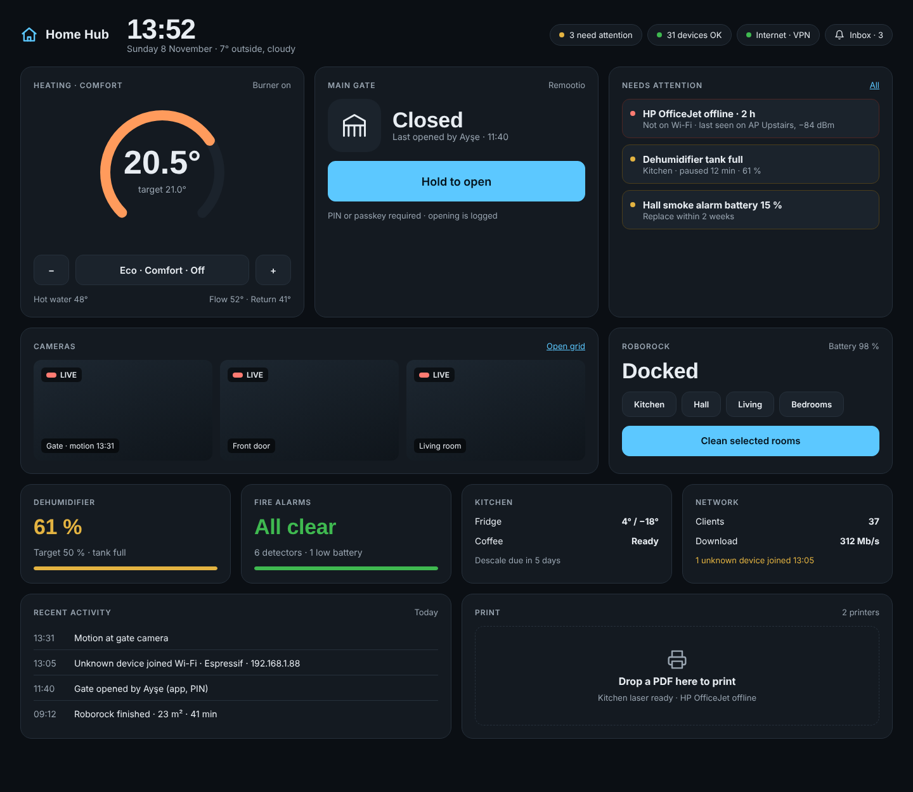

# my-home-dashboard: Home Hub

A self-hosted home platform with a **Java backend** and a **modern browser UI**. It brings every device in the house onto one clean dashboard: gate, heating, fire alarms, dehumidifier, robot vacuum, printers, cameras, network, fridge and coffee machine. **Device health** and a **unified notification inbox** are first-class features.

> **Status:** Phase 1 of 20 (Design) is complete and the UI direction is chosen. Implementation starts in Phase 2.



## Start here

| Document | Description |
|----------|-------------|
| [Home-Hub-Design.pdf](Home-Hub-Design.pdf) | **Main design document**: the whole design in one read (21 pages, diagrams and UI included) |
| [Home-Hub-Design.html](Home-Hub-Design.html) | The same document as a web page (diagrams render live in the browser) |
| [design/](design/00-README.md) | Detailed design documents (architecture, domain model, SDK, sequences, integrations, security, UI, decisions, roadmap) |
| [design/mockups/](design/mockups/README.md) | The three dashboard mockups; **B · Night Console** was chosen |

## What it does

- **One dashboard**: every device on one live, glanceable screen, from a laptop, a phone or a wall tablet.
- **Health first**: every device has a computed state (online, degraded, offline, cloud unreachable) with a human-readable reason, such as *"Offline: not connected to Wi-Fi (last seen on AP Upstairs, −84 dBm)"*. Problems open incidents, which feed the uptime history.
- **One inbox**: notifications from every device in one place, de-duplicated, with acknowledge/snooze, quiet hours and auto-resolve. Delivered by Web Push and email (optionally ntfy). Smoke and CO alerts are CRITICAL and always break through.
- **Direct control**: open the gate (PIN or passkey required), set the heating, clean selected rooms, or drag a PDF onto the dashboard to print it.
- **Network awareness**: every client on the LAN is listed, unknown devices raise an alert, and the router and VPN router status is shown.
- **Driver SDK**: new integrations are written as Java plug-ins or as sidecar containers in any language, talking to the hub over MQTT.
- **Local and secure**: local protocols first, VPN-only remote access, encrypted credentials, an audit log, and step-up confirmation for dangerous commands.

It is deliberately **not** a Home Assistant clone. It focuses on the devices this household owns and grows through open standards (MQTT, Tuya, Zigbee2MQTT, Matter).

## User interface

The chosen direction is **Night Console**, a dark 12-column tile grid:

| Row | Tiles |
|-----|-------|
| Header | Large clock, date and weather · status pills (attention, devices OK, internet/VPN) · inbox |
| 1 | Heating dial · main gate with *Hold to open* · "Needs attention" list |
| 2 | Live camera tiles (WebRTC) · Roborock with room selection |
| 3 | Dehumidifier · fire alarms · kitchen (fridge, coffee) · network |
| 4 | Recent activity feed · print drop zone |

The grid adapts to tablet and phone widths and doubles as a **kiosk mode** for a wall tablet. A light theme is available as a setting. For the tokens, layout rules and card states, see [design/07-ui-ux-design.md](design/07-ui-ux-design.md).

## How it works

```
 Browser (React PWA) ⇄ REST + WebSocket ⇄ hub-app (Spring Boot)
                                            ├─ Device Registry · Command Service
                                            ├─ Event Bus → State · Health · Notifications · History · Rules
                                            └─ Driver layer ─┬─ in-process Java drivers ──→ LAN devices / vendor clouds
                                                             └─ Sidecar Bridge ⇄ MQTT ⇄ sidecar containers (Python…)
                    PostgreSQL + TimescaleDB · Mosquitto · go2rtc (cameras)
```

- Every vendor protocol is translated at the edge into one internal model: **Device → Capability → State / Command / Event**. The core, UI and rules never see a vendor protocol.
- Drivers run either **in-process** (Java SPI), or **out-of-process** as sidecars speaking a small MQTT "Driver Protocol". Sidecars let us reuse mature community libraries such as python-roborock.
- Cloud APIs with strict quotas (e.g. Viessmann: 1,450 calls/day) are protected by a central **rate-budget manager**, with a reserve kept for user commands.
- Health is **computed** from heartbeats, last-seen times, fault codes and connectivity, not trusted from vendors.

Diagrams: [component architecture](design/01-architecture-overview.md#5-component-architecture-backend) · [sequence diagrams](design/04-sequence-diagrams.md) · [Docker topology](design/06-security-and-deployment.md#4-docker-topology).

## Planned devices

| Device | Integration | Local / cloud | Phase |
|--------|-------------|---------------|-------|
| Remootio main gate | WebSocket API v2 (encrypted), mDNS discovery | Local | 12 |
| HP & other printers | IPP Everywhere, print from the dashboard | Local | 13 |
| Routers, VPN router, network clients | Router APIs + ARP / mDNS / SNMP, Wi-Fi survey | Local | 14 |
| X-Sense fire alarms | Official SBS50 MQTT bridge to our broker (cloud fallback) | Local | 15 |
| Viessmann ViCare heating | Official REST API, OAuth PKCE, rate-limited | Cloud | 16 |
| ProBreeze dehumidifier | Tuya local protocol with a device profile | Local | 17 |
| Roborock vacuum | Local TCP via a python-roborock sidecar | Local | 18 |
| IP cameras | ONVIF + go2rtc → WebRTC in the browser | Local | 19 |
| Fridge & coffee machine | Vendor API (Home Connect / SmartThings / ThinQ) | Cloud | 20 |

After v1.0, lights and sensors come through Zigbee2MQTT and Matter, reusing the generic MQTT-discovery and Tuya drivers without new code.

## Technology

| Layer | Choice |
|-------|--------|
| Backend | Java 25 (virtual threads), Spring Boot 4, Maven multi-module (modular monolith) |
| Data | PostgreSQL 17 + TimescaleDB, Flyway migrations |
| Messaging | Typed in-process event bus; Eclipse Mosquitto (MQTT 5) at the edge |
| API | REST (OpenAPI 3) + WebSocket / STOMP for live updates |
| Frontend | React 19, TypeScript, Vite, Tailwind, shadcn/ui, TanStack Query, ECharts (installable PWA) |
| Media & printing | go2rtc (RTSP → WebRTC), IPP Everywhere (+ optional CUPS) |
| Security | Spring Security, Argon2id, TOTP / passkeys, AES-256-GCM credential vault |
| Deployment | Docker Compose on a single home server, Caddy for TLS, GitHub Actions CI |

## Security at a glance

- **No port forwarding.** Remote access goes through the VPN router only.
- **Step-up confirmation** (PIN or passkey) to open the gate or run other dangerous commands, and every command is audit-logged.
- **Vendor credentials are encrypted** with AES-256-GCM. The master key is kept outside the database, and secrets are write-only through the API.
- **Sidecars are isolated**: non-root, read-only, each with its own MQTT user and topic ACL.
- **Not a life-safety system.** The hub is a secondary alert channel. The smoke detectors and their official app remain primary.

## Getting started

Not runnable yet. From Phase 6 the whole stack will start with:

```bash
git clone https://github.com/syucel1/my-home-dashboard.git
cd my-home-dashboard/deploy
cp .env.example .env          # set passwords and host name
docker compose up -d          # → https://hub.local
```

Planned requirements: a home server or mini PC with Docker (x86-64 or ARM64, 8 GB RAM recommended) on the same LAN as the devices.

## Repository layout

```
my-home-dashboard/
├── Home-Hub-Design.pdf / .html   main design document
├── design/                       detailed design
│   ├── 00-README.md              index and reading guide
│   ├── 01-architecture-overview.md
│   ├── 02-domain-model.md
│   ├── 03-driver-sdk-and-messaging.md
│   ├── 04-sequence-diagrams.md
│   ├── 05-integration-specs.md
│   ├── 06-security-and-deployment.md
│   ├── 07-ui-ux-design.md
│   ├── 08-decisions-and-open-questions.md
│   ├── 09-roadmap.md
│   ├── diagrams/                 rendered PNGs of every Mermaid diagram
│   └── mockups/                  dashboard mockups (A, B ✔, C)
└── LICENSE
```

From Phase 2, source code will be added under `backend/`, `ui/`, `sidecars/` and `deploy/`.

## Roadmap

There are 20 small phases, each ending with a running system (roughly 9–10 months part-time). See [design/09-roadmap.md](design/09-roadmap.md) for scope and exit criteria.

| Stage | Phases |
|-------|--------|
| A · Design | 1 Design ✅ (incl. UI direction) |
| B · Foundation | 2 Repository & build · 3 Domain core & event bus · 4 Persistence · 5 REST + WebSocket API · 6 Dockerise · 7 UI shell (Night Console) |
| C · Platform | 8 Driver SDK · 9 Security · 10 Health monitor · 11 Notifications |
| D · Integrations | 12 Remootio · 13 Printers · 14 Network · 15 MQTT + X-Sense · 16 ViCare · 17 Tuya / ProBreeze · 18 Roborock · 19 Cameras · 20 Appliances, hardening, v1.0 |

## Key decisions

The [architecture decision records](design/08-decisions-and-open-questions.md) include:
- a modular monolith in Java 25 + Spring Boot 4;
- a capability-based device model;
- an in-process event bus, with MQTT only at the edge;
- polyglot drivers (Java SPI + MQTT sidecars);
- VPN-only remote access;
- PostgreSQL + TimescaleDB only;
- a generic MQTT-discovery driver;
- Night Console as the UI direction.

Open questions (device models, router brand, host hardware) are listed in the same document, each with a default.

## License

See [LICENSE](LICENSE).
