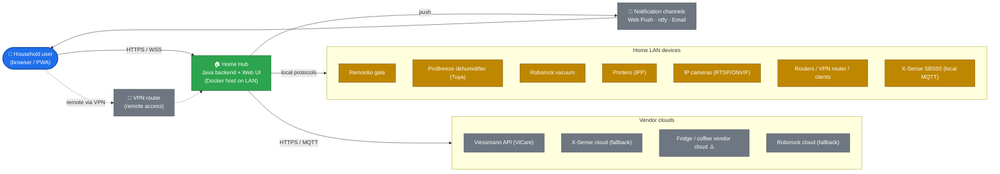
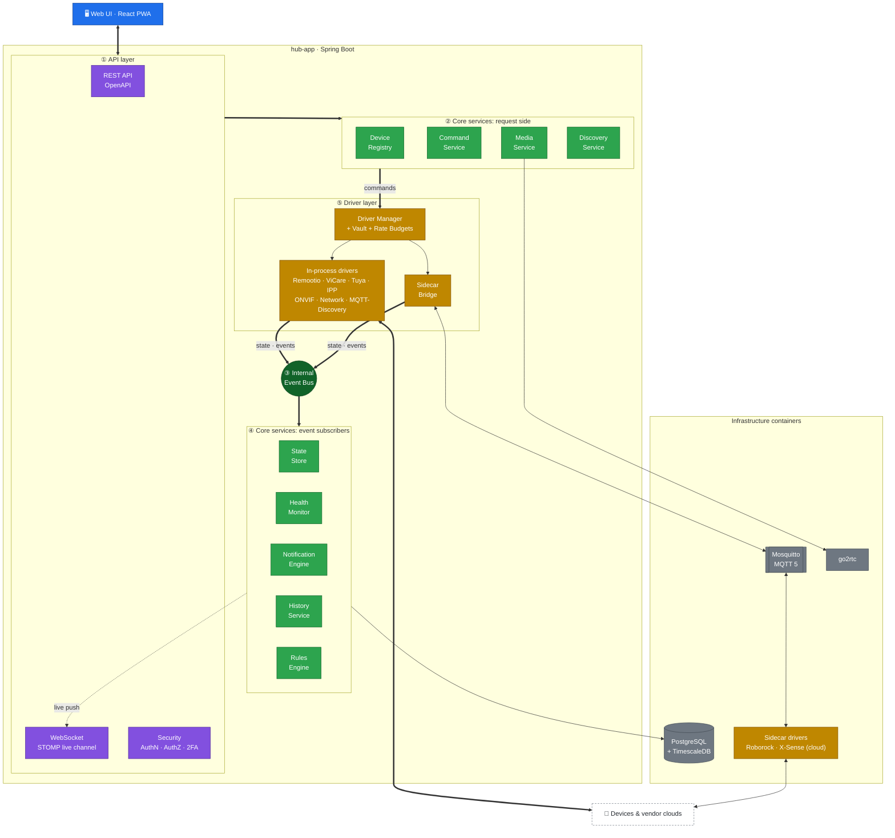
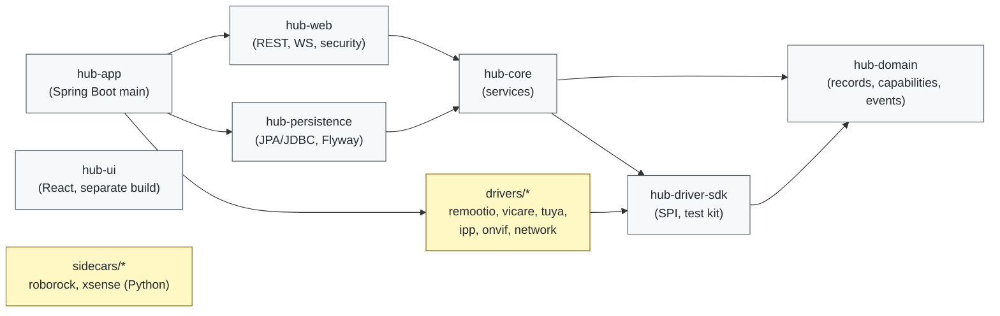
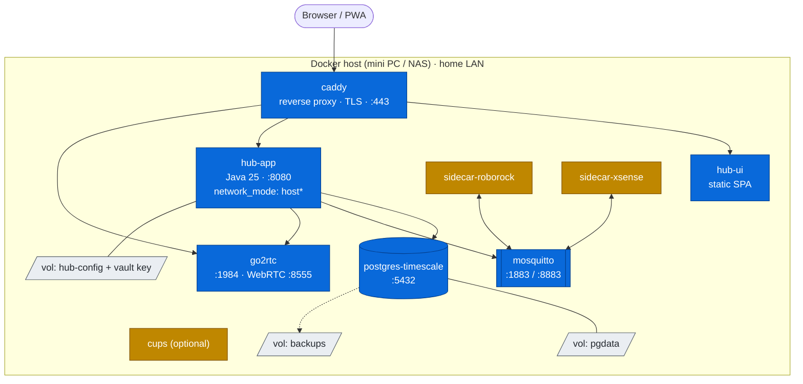

# 01: Architecture Overview

## 1. Goals and non-goals

### Goals
| ID | Goal |
|----|------|
| G1 | Integrate the household's devices: gate, heating, fire alarms, dehumidifier, robot vacuum, printers, cameras, network/routers, fridge and coffee machine |
| G2 | Show **health** as a first-class concept: online/offline/degraded, the reason, how long, and the history |
| G3 | Provide a **unified notification inbox** with severity, de-duplication, acknowledge/snooze and delivery channels |
| G4 | Make control **fast and safe**: optimistic UI, confirmed state, and step-up confirmation for dangerous commands |
| G5 | **Local-first**: prefer LAN protocols, degrade gracefully when the internet is down, and show clearly what depends on the cloud |
| G6 | Make adding a new integration a matter of **days, not weeks** (the Driver SDK) |
| G7 | Run as a **single `docker compose up`** on one home server |

### Non-goals (for v1.0)
- Feature parity with Home Assistant.
- A visual automation builder. Only simple rules come in v1; a builder is in the post-v1 backlog.
- Native mobile apps. The UI is a responsive PWA (installable web app) instead.
- Multi-home or multi-tenant SaaS.
- Being the *primary* life-safety alerting system. See [ADR-007](08-decisions-and-open-questions.md).

## 2. Architectural principles

1. **One internal language.** Every vendor protocol is translated at the edge, into the *Device → Capability → State/Command/Event* model. The core, the UI and the rules engine never see a vendor protocol.
2. **Drivers are plug-ins.** A driver runs either *in-process* (a Java SPI) or *out-of-process* (a sidecar container, written in any language, speaking the Driver Protocol over MQTT). This lets us reuse mature community libraries (python-roborock, python-xsense, tinytuya) without porting them.
3. **Events are the source of truth.** State changes are events. The current state is a projection of them, and history is the stored stream.
4. **Health is computed, not reported.** The Health Monitor derives health from heartbeats, last-seen times, error states and driver connectivity. It does not rely on vendors to say "I'm broken".
5. **Budgets for cloud APIs.** Every cloud integration declares a rate budget (for example, ViCare allows 1,450 calls per day). The platform enforces it centrally.
6. **Secure by default.** Credentials are encrypted at rest. Dangerous commands (opening the gate) need step-up confirmation. Remote access is VPN-only.
7. **Boring core, exciting edges.** The core is Spring Boot, PostgreSQL and MQTT, all well understood. The innovation lives in the drivers and the UX.

## 3. Technology stack

| Layer | Choice | Why |
|-------|--------|-----|
| Language | **Java 25 (LTS)** | Virtual threads give cheap concurrency across many device connections; records and sealed types suit the domain model |
| Framework | **Spring Boot 4.x** | Mature ecosystem: WebSocket, Security, Data, Actuator, scheduling |
| Build | **Maven** multi-module | Clean module boundaries (core, SDK, drivers, app) |
| Database | **PostgreSQL 17 + TimescaleDB** | Relational data for the registry and config; time-series (hypertables) for state history and metrics |
| Migrations | **Flyway** | Versioned schema |
| Internal bus | **In-process event bus** (Spring `ApplicationEventPublisher`, or a small typed bus on virtual threads) | Simple, fast, no broker needed for core-to-core traffic |
| External bus | **Eclipse Mosquitto (MQTT 5)** | The protocol for sidecar drivers; also receives the X-Sense SBS50 local bridge and other HA-discovery MQTT devices (Zigbee2MQTT, Tasmota, Shelly) |
| Java MQTT client | **HiveMQ MQTT Client** | MQTT 5, async, well maintained |
| API | **REST (OpenAPI 3)** + **WebSocket (STOMP)** | REST for queries and commands; WebSocket for live state, events and notifications |
| Frontend | **React 19 + TypeScript + Vite** | Large ecosystem and strong typing |
| UI kit | **Tailwind CSS + shadcn/ui + Radix**, **TanStack Query**, **Zustand** | Clean modern look; server-state caching; light client state |
| Charts | **Apache ECharts** | Rich time-series charts for history |
| Video | **go2rtc** (sidecar) | Turns RTSP/ONVIF camera streams into WebRTC/HLS for the browser |
| Printing | **IPP** via a Java IPP client (plus an optional **CUPS** sidecar for legacy printers) | Standards-based direct printing |
| Push notifications | **Web Push (VAPID)**, **ntfy** (self-hosted), email (SMTP) | No third-party dependency needed |
| Auth | Spring Security, **Argon2id** passwords, **TOTP 2FA**, **WebAuthn/passkeys** (phase 9+) | Strong local auth |
| Observability | Spring Actuator, **Micrometer → Prometheus**, structured JSON logs, optional Grafana | Gives the hub its own health metrics |
| Packaging | **Docker** images (Jib for Java, multi-stage builds for the UI), **Docker Compose** | Single-host deployment |
| CI | GitHub Actions | Build, test and image publish |

## 4. System context

## 5. Component architecture (backend)

The diagram shows the layers and the main flows only. Detailed interactions are covered in the table below and in the [sequence diagrams](04-sequence-diagrams.md).

### 5.1 Component responsibilities

| Component | Responsibility | Key interfaces |
|-----------|----------------|----------------|
| **REST API** | CRUD for devices, rooms and settings; issuing commands; queries (history, notifications) | `/api/v1/**`, OpenAPI spec |
| **WebSocket channel** | Pushes `StateChanged`, `DeviceEvent`, `HealthChanged`, `NotificationRaised` and `CommandStatus` to the UI | STOMP topics `/topic/devices/{id}`, `/topic/notifications`, `/user/queue/commands` |
| **Security** | Session/JWT auth, roles (`ADMIN`, `MEMBER`, `GUEST`), TOTP, step-up confirmation for dangerous commands | Spring Security filter chain |
| **Device Registry** | Holds the devices, their capabilities, rooms, tags and driver bindings | `DeviceRepository`, `DeviceRegistry` |
| **State Store** | Keeps the current value of every capability attribute (in-memory cache backed by Postgres); serves snapshots | `StateStore.get(deviceId)` |
| **Command Service** | Validates commands against capability schemas, enforces permissions and step-up, dispatches to drivers, tracks the command lifecycle (`PENDING → SENT → CONFIRMED / FAILED / TIMEOUT`) | `CommandService.submit()` |
| **Event Bus** | Typed in-process pub/sub on virtual threads; at-least-once delivery inside the process | `EventBus.publish()`, `@Subscribe` |
| **Health Monitor** | Tracks heartbeats and last-seen times, evaluates health rules, opens and closes **incidents** | `HealthPolicy`, `Incident` |
| **Notification Engine** | Turns events and incidents into notifications; de-duplicates, groups, applies quiet hours, routes to channels | `NotificationRule`, `Channel` SPI |
| **History Service** | Writes state changes to TimescaleDB hypertables; runs downsampling and retention; serves charts | `/api/v1/history` |
| **Discovery Service** | Scans for new devices (mDNS, SSDP/UPnP, ONVIF WS-Discovery, ARP table) and suggests them for onboarding | `DiscoveryProvider` SPI |
| **Rules Engine** | Simple "when X then Y" rules, e.g. "dehumidifier tank full → notify" or "everyone away → start vacuum" | `Rule`, `Condition`, `Action` |
| **Credential Vault** | Encrypts driver secrets (API keys, passwords, Tuya local keys) with AES-256-GCM, using a master key held outside the database | `Vault.get(ref)` |
| **Rate-Budget Manager** | Token-bucket budgets per cloud account; drivers ask before calling | `Budget.tryAcquire()` |
| **Media Service** | Manages camera stream sessions (through go2rtc) and print jobs (through IPP) | `/api/v1/media/**` |
| **Driver Manager** | Discovers driver plug-ins, validates config, starts and stops drivers, restarts them with back-off, isolates failures | `DriverManager` |
| **Sidecar Bridge** | Implements the Driver Protocol over MQTT so that sidecars look like any other driver | Topics `hub/v1/drv/{driverId}/**` |

## 6. Code modules (Maven)

**Rule:** drivers depend **only** on `hub-driver-sdk` (and through it on `hub-domain`). This is enforced with ArchUnit tests.

## 7. Container / deployment view

\* `hub-app` uses **host networking** (or a macvlan network) so that it can receive mDNS/SSDP multicast and reach LAN devices directly. Bridge networking breaks multicast discovery. See [06 Security & Deployment](06-security-and-deployment.md#4-docker-topology).

## 8. Quality attributes

| Attribute | Target |
|-----------|--------|
| Command latency (local device) | p95 < 500 ms from click to device acknowledgement |
| State propagation (push devices) | p95 < 1 s from device to UI |
| Offline detection | ≤ 2× the device's heartbeat interval (e.g. ≤ 2 min for 60-second polling) |
| Hub start-up | < 20 s to a ready dashboard |
| Footprint | < 1 GB RAM total for the whole stack, excluding camera transcoding |
| Availability | Survives the internet going down: local devices keep working, and cloud devices show as "cloud unreachable" rather than "broken" |
| Resilience | One driver crashing must not affect the others (supervised restarts with exponential back-off) |
| Data retention | Raw state for 30 days, hourly roll-ups for 2 years, notifications for 1 year (all configurable) |
