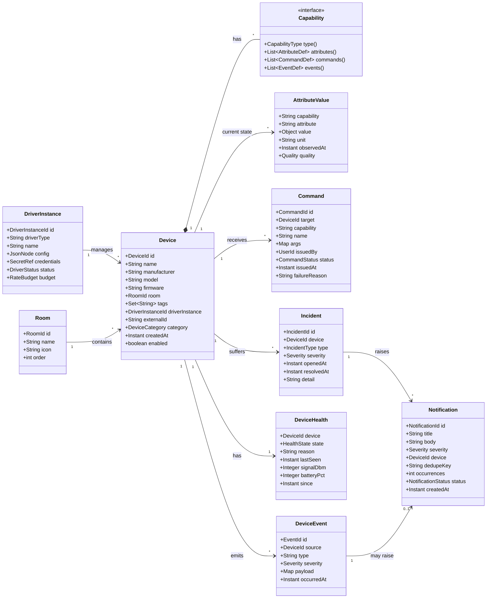
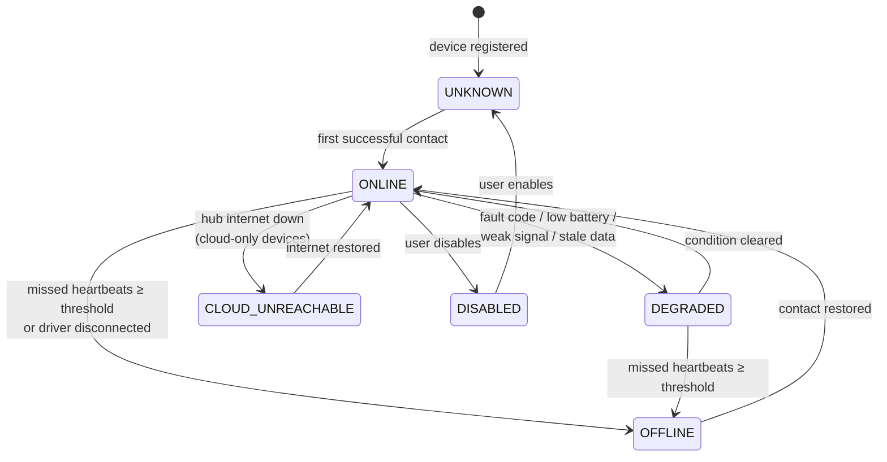
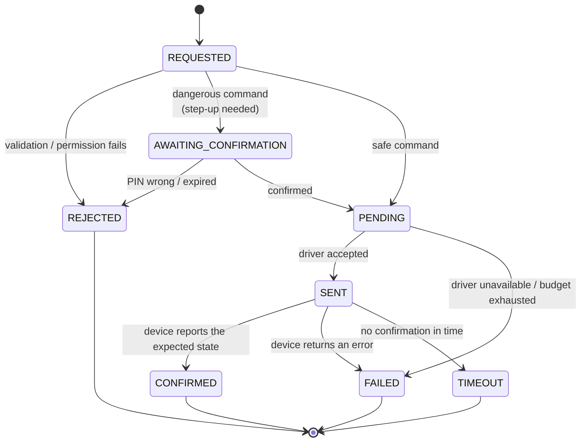
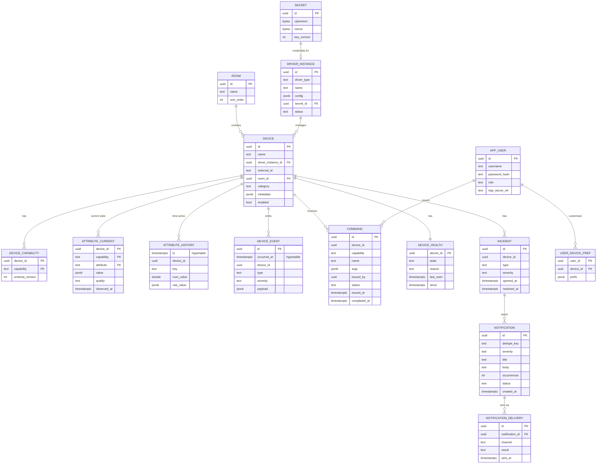

# 02: Domain Model

The domain model is the **single internal language** of Home Hub. Every driver translates its vendor protocol into these concepts, and every other part of the system works only with them.

## 1. Core concepts

| Concept | Definition | Example |
|---------|------------|---------|
| **Device** | A physical or logical thing we monitor or control | "Main gate", "Kitchen dehumidifier", "Boiler" |
| **Driver** | The plug-in that knows how to talk to a family of devices | `remootio`, `vicare`, `tuya-local` |
| **Driver Instance** (Integration) | A configured driver, i.e. a driver plus credentials and account | "ViCare account serkan@…" |
| **Capability** | A typed, reusable feature that a device has | `Switch`, `Gate`, `Thermostat`, `HumiditySensor`, `Vacuum`, `Printer`, `Camera`, `SmokeAlarm`, `Battery` |
| **Attribute** | A named, typed value that belongs to a capability | `Gate.position = OPEN`, `HumiditySensor.humidity = 61 %` |
| **Command** | A typed action defined by a capability | `Gate.open()`, `Thermostat.setTarget(21.5)` |
| **Event** | Something that happened, carrying a timestamp and a source | `Gate.Opened{by: "app"}`, `SmokeAlarm.Triggered` |
| **Health** | The computed connectivity and condition of a device | `ONLINE`, `DEGRADED`, `OFFLINE`, `UNKNOWN` |
| **Incident** | An open problem on a device, with a start time and an end time | "Dehumidifier offline since 09:14" |
| **Notification** | A message for users, derived from events and incidents | "⚠️ Dehumidifier tank full" |
| **Room / Zone** | A user-defined grouping | "Kitchen", "Garden", "Network rack" |

## 2. Class diagram

## 3. Capability catalogue (v1)

Capabilities are defined in `hub-domain` as Java sealed interfaces and records. Each one has a stable **schema ID** (e.g. `hub.cap.gate/1`), so that sidecars written in other languages can use them through JSON.

| Capability | Attributes | Commands | Events | Used by |
|-----------|------------|----------|--------|---------|
| `Availability` *(implicit on every device)* | `online: bool`, `lastSeen: Instant` | — | `WentOnline`, `WentOffline` | all |
| `Gate` | `position: OPEN/CLOSED/OPENING/CLOSING/UNKNOWN`, `lastActor: String` | `open()`, `close()`, `trigger()` | `Opened`, `Closed`, `LeftOpen(duration)` | Remootio |
| `Switch` | `on: bool` | `turnOn()`, `turnOff()`, `toggle()` | `Changed` | Tuya, lights (later) |
| `Thermostat` | `currentTemp °C`, `targetTemp °C`, `mode: HEAT/ECO/COMFORT/OFF/AUTO`, `heatingActive: bool` | `setTarget(t)`, `setMode(m)` | `ModeChanged` | ViCare |
| `WaterHeater` | `dhwTemp °C`, `dhwTarget °C`, `dhwMode` | `setDhwTarget(t)`, `oneTimeCharge()` | — | ViCare |
| `BoilerDiagnostics` | `flowTemp`, `returnTemp`, `outsideTemp`, `burnerActive`, `burnerHours`, `burnerStarts`, `pressureBar`, `errorCodes[]` | — | `Fault(code)` | ViCare |
| `HumiditySensor` | `humidity %` | — | — | Tuya dehumidifier, others |
| `TemperatureSensor` | `temperature °C` | — | — | many |
| `Dehumidifier` | `targetHumidity %`, `mode: AUTO/CONTINUOUS/LAUNDRY/SLEEP`, `fanSpeed`, `tankFull: bool`, `faultCode` | `setTargetHumidity(h)`, `setMode(m)`, `setFan(s)` | `TankFull`, `Fault(code)` | ProBreeze |
| `Vacuum` | `status: DOCKED/CLEANING/RETURNING/PAUSED/ERROR/CHARGING`, `areaM2`, `durationMin`, `fanPower`, `errorCode` | `start()`, `pause()`, `dock()`, `locate()`, `cleanRooms(ids[])`, `setFanPower(p)` | `Started`, `Finished(summary)`, `Stuck`, `Error(code)` | Roborock |
| `Consumables` | `items[]: {name, remainingPct}` | `reset(name)` | `NeedsReplacement(name)` | Roborock, dehumidifier filter, printer ink |
| `Battery` | `level %`, `charging: bool`, `low: bool` | — | `Low` | vacuum, smoke alarms |
| `SmokeAlarm` | `smoke: CLEAR/DETECTED`, `co: CLEAR/DETECTED` *(if CO model)*, `lastTest: Instant`, `muted: bool` | `test()` *(if the API allows)* | `SmokeDetected`, `CoDetected`, `Cleared`, `TestPerformed` | X-Sense |
| `Printer` | `state: IDLE/PRINTING/STOPPED`, `stateReasons[]`, `queueLength`, `media[]` | `print(document, options)`, `cancel(jobId)` | `JobCompleted`, `JobFailed`, `PaperOut`, `Jammed` | IPP |
| `Camera` | `streams[]: {name, codec, resolution}`, `motion: bool`, `recording: bool` | `snapshot()`, `ptz(dir)` *(if supported)* | `MotionDetected` | ONVIF |
| `NetworkRouter` | `wanUp: bool`, `wanIp`, `uptime`, `clientsCount`, `throughput{rx,tx}`, `vpnTunnels[]` | `reboot()` *(admin, step-up)* | `WanDown`, `WanUp`, `NewClientJoined` | Network |
| `NetworkClient` | `mac`, `ip`, `hostname`, `vendor`, `band`, `rssi`, `connectedSince`, `knownDevice: bool` | `block()` *(if the router supports it)* | `Joined`, `Left` | Network |
| `WifiSurvey` | `networks[]: {ssid, bssid, channel, rssi, security}` | `rescan()` | — | Network |
| `Appliance` | `programState`, `remainingMin`, `doorOpen: bool`, `faults[]` | per vendor | `ProgramFinished`, `DoorLeftOpen` | Fridge, coffee machine ⚠️ |
| `Fridge` | `fridgeTemp`, `freezerTemp`, `targetTemps`, `doorOpen` | `setTarget(zone, t)`, `superCool()` | `DoorAlarm`, `TempAlarm` | Fridge ⚠️ |
| `CoffeeMaker` | `state`, `waterTankEmpty`, `beansEmpty`, `descaleDue`, `cupCounter` | `brew(recipe)` *(if the vendor allows remote start)* | `NeedsWater`, `NeedsDescaling` | Coffee machine ⚠️ |
| `PowerMeter` *(future)* | `powerW`, `energyKWh` | — | — | smart plugs |
| `Light` *(future)* | `on`, `brightness`, `colorTemp`, `rgb` | `set(...)` | — | Zigbee / Matter |

**Attribute quality.** Every value carries a `Quality`:

- `GOOD`: fresh.
- `STALE`: older than the device's expected refresh interval.
- `ESTIMATED`: an optimistic update that the device has not yet confirmed.
- `BAD`: the driver reported an error.

The UI dims stale values and shows a spinner for estimated ones.

## 4. Health model

**Health is computed** by the Health Monitor from these inputs:

1. **Heartbeat / last-seen.** Each driver declares `expectedRefresh` for each device (push devices: keep-alive interval; polled devices: poll interval). Missing `missedThreshold × expectedRefresh` (default 2×) marks the device OFFLINE.
2. **Driver connectivity.** If a driver's connection or session drops (e.g. the Remootio WebSocket closes), its devices go OFFLINE immediately, with the reason "Connection to device lost".
3. **Condition rules.** Fault codes, `Battery.low`, signal below −80 dBm, `tankFull` and consumables under 10 % mark the device DEGRADED, with a human-readable reason.
4. **Hub connectivity.** If the hub's own internet check fails, cloud-dependent devices move to `CLOUD_UNREACHABLE`, not `OFFLINE`. This avoids a flood of false alarms.

Each transition into OFFLINE or DEGRADED opens an **Incident**, and the reverse transition resolves it. Incidents give the "malfunction history" view and figures such as "uptime 99.2 % over the last 30 days".

## 5. Command lifecycle

## 6. Notification model

| Field | Notes |
|-------|-------|
| `severity` | `INFO`, `WARNING`, `CRITICAL`. CRITICAL bypasses quiet hours. |
| `dedupeKey` | e.g. `dehumidifier-01:TankFull`. While a notification is open, repeats increment `occurrences` instead of creating new notifications. |
| `status` | `NEW → SEEN → ACKNOWLEDGED → RESOLVED`, or `SNOOZED(until)` |
| `autoResolve` | Notifications linked to an incident resolve themselves when the incident closes. |
| `channels` | Chosen by routing rules: `IN_APP` (always), `WEB_PUSH`, `NTFY`, `EMAIL` |

**Default notification rules (v1):**

| Trigger | Severity | Channels |
|---------|----------|----------|
| Smoke or CO detected | CRITICAL | all |
| Gate left open > 10 min | WARNING | push |
| Gate opened while "Away" mode is on | WARNING | push |
| Device offline > 5 min (configurable per device) | WARNING | push |
| Boiler fault code | WARNING | push + email |
| Dehumidifier tank full | INFO | push |
| Vacuum stuck or error | INFO | push |
| Smoke alarm battery low | WARNING | push + email |
| Printer out of paper or ink | INFO | in-app |
| Unknown device joined the network | WARNING | push |
| WAN down / restored | WARNING / INFO | in-app (+ push once restored) |

## 7. Persistence model (PostgreSQL + TimescaleDB)

**Retention (TimescaleDB policies):**

| Table | Raw retention | Aggregates |
|-------|---------------|------------|
| `attribute_history` | 30 days | Hourly aggregates (`avg`, `min`, `max`, `last`) kept for 2 years |
| `device_event` | 1 year | none |
| `command` | 1 year | none |

## 8. Identity and naming

- **`DeviceId`**: a UUID v7 (time-ordered), assigned by the hub.
- **`externalId`**: the driver's own stable identifier, such as a serial number, MAC address, Tuya `devId` or Viessmann `installationId/gatewaySerial/deviceId`. The pair `(driverInstance, externalId)` is unique. This makes **re-discovery idempotent**: rediscovering a device never creates a duplicate.
- **Capability keys** are written as `capability.attribute`, e.g. `thermostat.targetTemp`. They are used in history, rules and the UI.
