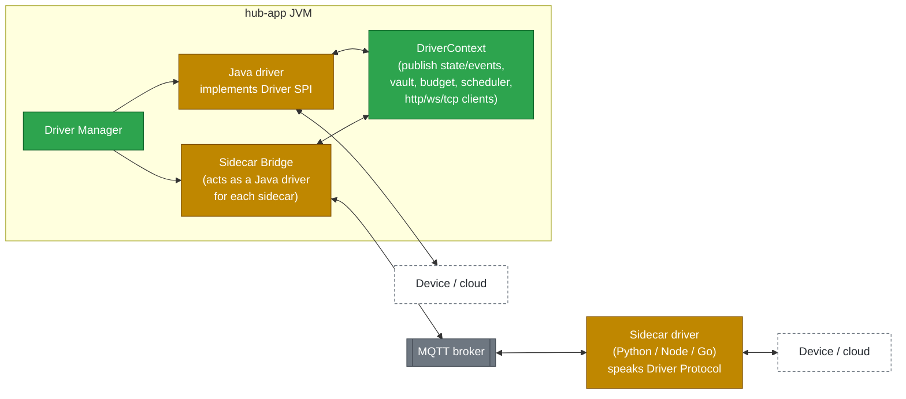
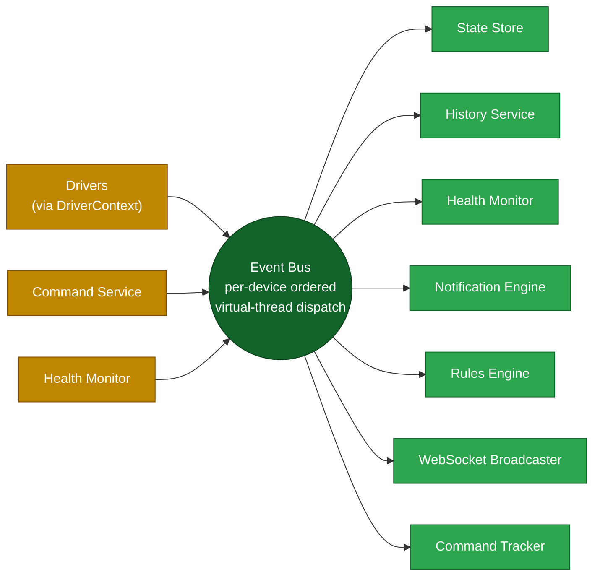

# 03: Driver SDK & Messaging

Every vendor uses its own protocol: encrypted WebSockets (Remootio), OAuth REST with strict quotas (ViCare), AES-encrypted TCP (Tuya), RTSP (cameras), IPP (printers), reverse-engineered cloud MQTT (X-Sense, Roborock). This document explains how **all of them plug into one model**.

## 1. Two kinds of driver, one contract



| | **In-process (Java SPI)** | **Sidecar (MQTT Driver Protocol)** |
|---|---|---|
| When to use | Documented or simple protocols; best performance | A mature library exists in another language (python-roborock, python-xsense); the protocol is reverse-engineered and changes often; the vendor SDK is not in Java |
| Isolation | Supervised by the Driver Manager on its own virtual threads; a crash is caught and the driver restarted | Its own container: full process isolation, separate restart policy |
| Deployment | Bundled in `hub-app` (or dropped in as a plug-in JAR) | Its own Docker image, added to Compose |
| v1 drivers | Remootio, ViCare, Tuya-local, IPP, ONVIF, Network, **MQTT-Discovery** (X-Sense SBS50 local bridge; later Zigbee2MQTT/Tasmota/Shelly) | Roborock, X-Sense cloud fallback |

The core cannot tell the two apart: the Sidecar Bridge presents each sidecar as a normal `Driver`.

## 2. The Java Driver SPI

```java
// hub-driver-sdk

public interface DriverFactory {
    DriverDescriptor descriptor();          // id, name, version, icon, capabilities, config schema
    Driver create(DriverContext ctx, DriverConfig config);
}

public interface Driver extends AutoCloseable {
    /** Connect, authenticate, enumerate devices. Called once by the Driver Manager. */
    void start() throws DriverException;

    /** Optional: active discovery of devices this driver could add. */
    default List<DiscoveredDevice> discover(Duration timeout) { return List.of(); }

    /** Execute a validated command. Return quickly; confirm via state/event publish. */
    CommandAck execute(DeviceCommand command) throws DriverException;

    /** Called on a schedule the driver requested (polling drivers). */
    default void poll(PollRequest request) {}

    /** Driver health for the Health Monitor. */
    DriverStatus status();

    @Override void close();
}

public interface DriverContext {
    void upsertDevice(DeviceDescriptor d);           // register / update a device
    void publishState(String externalId, StateUpdate update);
    void publishEvent(String externalId, DeviceEventDraft event);
    void reportAvailability(String externalId, boolean online, String reason);

    Secrets secrets();                               // read decrypted credentials
    RateBudget budget(String key);                   // shared rate limiter
    Scheduler scheduler();                           // virtual-thread scheduling
    HttpClient http();                               // pre-configured, with metrics
    WebSocketFactory websockets();
    KeyValueStore store();                           // small private driver state (tokens, cursors)
    Logger log();
}
```

**Packaging:** drivers are found with `java.util.ServiceLoader` (`META-INF/services/…DriverFactory`). Each driver ships a **JSON Schema** for its config. The UI renders the "Add integration" form from that schema, so no per-driver UI code is needed.

**Driver test kit:** `hub-driver-sdk-testkit` provides a `FakeDriverContext`, recorded protocol fixtures and contract tests. Every driver must pass the same compliance suite: it publishes availability, it confirms commands, and it respects its budget.

## 3. The MQTT Driver Protocol (for sidecars)

Topic root: `hub/v1/drv/{driverInstanceId}/`. Payloads are JSON (UTF-8) and every message carries `msgId` and `ts`. MQTT 5 is used with **request/response properties** (`responseTopic`, `correlationData`).

| Direction | Topic | Purpose | QoS / Retain |
|-----------|-------|---------|--------------|
| Hub → sidecar | `…/config` | Driver config plus decrypted credentials (**retained, and only on a TLS + ACL-protected listener**) | 1 / retained |
| Sidecar → hub | `…/status` | `{"state":"RUNNING"\|"ERROR"\|"AUTH_FAILED","detail":…}`. A **Last Will** sets `OFFLINE` automatically | 1 / retained |
| Sidecar → hub | `…/devices` | Full device list with capabilities (`DeviceDescriptor[]`) | 1 / retained |
| Sidecar → hub | `…/dev/{externalId}/state` | `StateUpdate` (partial attribute map) | 0 / no |
| Sidecar → hub | `…/dev/{externalId}/event` | `DeviceEventDraft` | 1 / no |
| Sidecar → hub | `…/dev/{externalId}/availability` | `{"online":false,"reason":"…"}` | 1 / retained |
| Hub → sidecar | `…/dev/{externalId}/cmd` | `DeviceCommand` (with `correlationData`) | 1 / no |
| Sidecar → hub | response topic | `CommandAck` `{status: ACCEPTED\|REJECTED\|FAILED, detail}` | 1 / no |
| Hub → sidecar | `…/discover` | Request discovery; replies on the response topic | 1 / no |
| Sidecar → hub | `…/heartbeat` | Every 30 s, carrying `{uptime, version}` | 0 / no |

**Example state message:**
```json
{
  "msgId": "01JC9R8…",
  "ts": "2026-11-08T13:40:02Z",
  "attributes": {
    "vacuum.status": "CLEANING",
    "vacuum.areaM2": 23.5,
    "battery.level": 71
  }
}
```

**Example command:**
```json
{
  "msgId": "01JC9RA…",
  "commandId": "c7f1…",
  "capability": "vacuum",
  "name": "cleanRooms",
  "args": { "roomIds": ["16", "17"] }
}
```

A small **Python helper package (`homehub-sidecar`)** implements this protocol, so writing a sidecar is roughly a 100-line adapter around an existing library.

### MQTT security
- The broker allows **no anonymous access**. Each sidecar has its own username and password, created by the hub.
- **ACLs:** a sidecar can only read and write under `hub/v1/drv/{its own id}/#`.
- Credentials sent on `…/config` go over the internal Docker network only, on a TLS listener. The production option is to send a reference instead of the secret, with the sidecar fetching it through a one-time token.

## 4. Internal event bus

Inside the JVM, all state and events travel on a typed, in-process **Event Bus**:



**Event types** (sealed interface `HubEvent`):

| Event | Published by | Consumed by |
|-------|--------------|-------------|
| `StateChanged(deviceId, changes[], quality)` | drivers | State Store, History, Health, Rules, WS, Command Tracker |
| `DeviceEventOccurred(deviceId, type, severity, payload)` | drivers | Notifications, Rules, History, WS |
| `AvailabilityChanged(deviceId, online, reason)` | drivers, Health | Health, WS |
| `HealthChanged(deviceId, from, to, reason)` | Health Monitor | Notifications, WS, History |
| `IncidentOpened / IncidentResolved` | Health Monitor | Notifications, WS |
| `CommandStatusChanged(commandId, status)` | Command Service | WS (to the issuing user), History |
| `DeviceRegistered / DeviceRemoved` | Registry | WS, Health |
| `NotificationRaised / Updated` | Notification Engine | WS, Channel dispatchers |

**Guarantees:**
- **Per-device ordering.** Events for the same device are delivered in order: there is a mailbox per device, partitioned by `deviceId`.
- **Subscriber isolation.** A slow subscriber (e.g. email) never blocks the others; each subscriber has a bounded queue on virtual threads.
- **Durability.** The bus itself is in-memory. Durability comes from subscribers writing to Postgres. On restart, the current state is reloaded from `attribute_current`, then drivers resync.

**Why not Kafka or RabbitMQ?** A single-host home system does not need them. Keeping the bus in-process means no extra container, sub-millisecond latency and simpler operations. If we ever need to scale out, the `EventBus` interface allows the bus to be swapped for an MQTT- or NATS-backed one.

## 5. How the different integration styles map onto the SDK

| Integration style | Pattern inside the driver | Examples |
|-------------------|---------------------------|----------|
| **Local push (persistent socket)** | Open the connection in `start()` → listen loop on a virtual thread → `publishState` on each frame → reconnect with exponential back-off → `reportAvailability(false)` on disconnect | Remootio (WebSocket), Tuya local (TCP), ONVIF events |
| **Local poll** | `scheduler().every(interval, poll)` → query → diff → `publishState` | IPP printer status, router API, ARP table |
| **Cloud poll with quota** | Same as local poll, but `budget("vicare").tryAcquire()` comes first; adaptive interval; cache; `CLOUD_UNREACHABLE` handling | ViCare |
| **Cloud push** | Hold an OAuth session plus a cloud MQTT or WebSocket subscription; refresh tokens via `store()` | X-Sense cloud fallback (sidecar), Roborock cloud fallback (sidecar) |
| **Device publishes to our broker** | Subscribe to `homeassistant/+/+/config` discovery + state topics on Mosquitto → map HA component/device_class → capabilities | X-Sense SBS50 local bridge, Zigbee2MQTT, Tasmota, Shelly |
| **Media** | The driver only exposes stream URLs; the Media Service registers them with go2rtc; the browser connects to go2rtc by WebRTC | Cameras |
| **Job-based** | `execute(print)` → submit job → poll job status → events | Printers |
| **Passive observation** | Read from another system (router DHCP leases, ARP) → synthesise `NetworkClient` devices | Network clients |

## 6. Rate-budget manager

Cloud APIs punish over-use. ViCare, for example, blocks the account for 24 hours if a limit is exceeded. Every budget is declared **per account**, and the drivers and the UI share it:

```yaml
budgets:
  vicare:
    windows:
      - { limit: 1450, per: 24h, reserve: 150 }   # keep 150 for user commands
      - { limit: 120,  per: 10m, reserve: 10 }
    pollPolicy: adaptive      # slow down as usage approaches the limit
```

**How it behaves:**
- Polling calls draw on the budget **minus the reserve**. User commands may also use the reserve.
- The adaptive poller works out the safe interval as `window / (limit − reserve − alreadyUsed)` and spreads calls evenly.
- If the budget is exhausted, the driver stops polling, the device shows "Rate-limited, next refresh at 14:20", and commands fail fast with a clear message.
- Budget usage is visible on the Integration screen.
