# 04: Sequence Diagrams

These are the key runtime flows. Participant names match the components in [01 Architecture Overview](01-architecture-overview.md#5-component-architecture-backend).

| # | Flow | Shows |
|---|------|-------|
| [SD-01](#sd-01-hub-start-up-and-driver-loading) | Hub start-up & driver loading | Boot order, state recovery, supervision |
| [SD-02](#sd-02-device-discovery-and-onboarding-remootio-via-mdns) | Device discovery & onboarding | mDNS discovery, credentials into the vault, registration |
| [SD-03](#sd-03-user-opens-the-main-gate-dangerous-command-with-step-up) | Open the main gate | Step-up confirmation, encrypted local command, optimistic → confirmed |
| [SD-04](#sd-04-device-pushed-event-to-notification-dehumidifier-tank-full) | Device event → notification | Push event, dedupe, channels, live UI |
| [SD-05](#sd-05-cloud-polling-under-a-rate-budget-vicare-heating) | Cloud polling with a rate budget | ViCare adaptive polling, change heating target |
| [SD-06](#sd-06-device-goes-offline-and-recovers-health-and-incidents) | Device goes offline and recovers | Heartbeats, incident, notification, auto-resolve |
| [SD-07](#sd-07-live-camera-view-webrtc-via-go2rtc) | Live camera view | WebRTC via go2rtc |
| [SD-08](#sd-08-print-a-document-from-the-dashboard) | Print from the dashboard | Upload → IPP job → status |
| [SD-09](#sd-09-sidecar-driver-roborock-start-room-cleaning) | Sidecar driver command | Roborock over MQTT Driver Protocol |
| [SD-10](#sd-10-network-scan-and-unknown-device-alert) | Network scan & unknown device | Router API + ARP + mDNS merge |
| [SD-11](#sd-11-fire-alarm-x-sense-local-mqtt-bridge--cloud-fallback) | Fire alarm (X-Sense) | Official local MQTT bridge, cloud fallback, CRITICAL routing |
| [SD-12](#sd-12-login-with-2fa-and-live-session) | Login with 2FA & live session | Auth, WebSocket subscription, snapshot + deltas |

---

## SD-01 Hub start-up and driver loading

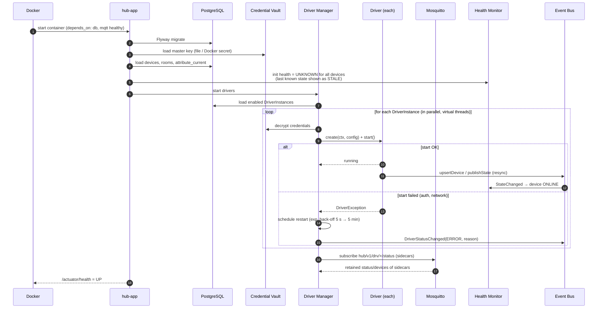

## SD-02 Device discovery and onboarding (Remootio via mDNS)

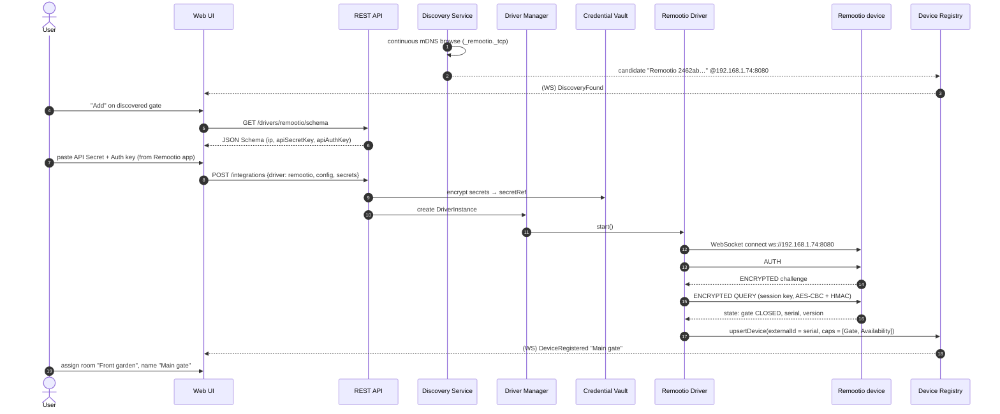

## SD-03 User opens the main gate (dangerous command with step-up)

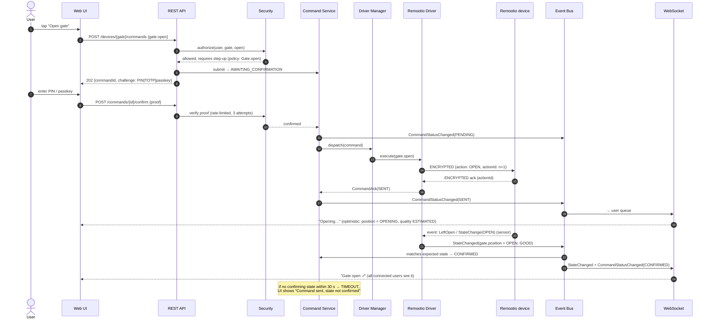

## SD-04 Device-pushed event to notification (dehumidifier tank full)

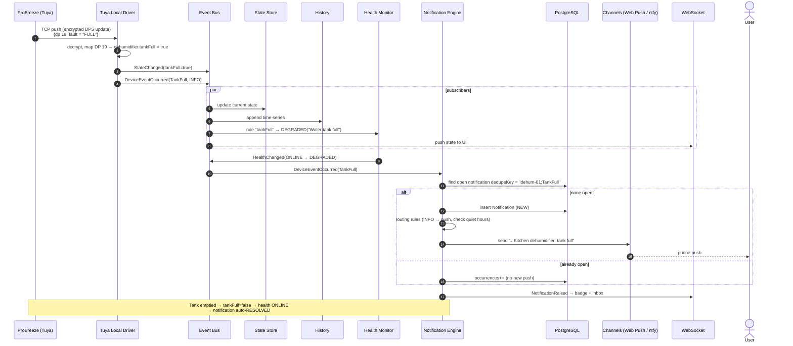

## SD-05 Cloud polling under a rate budget (ViCare heating)

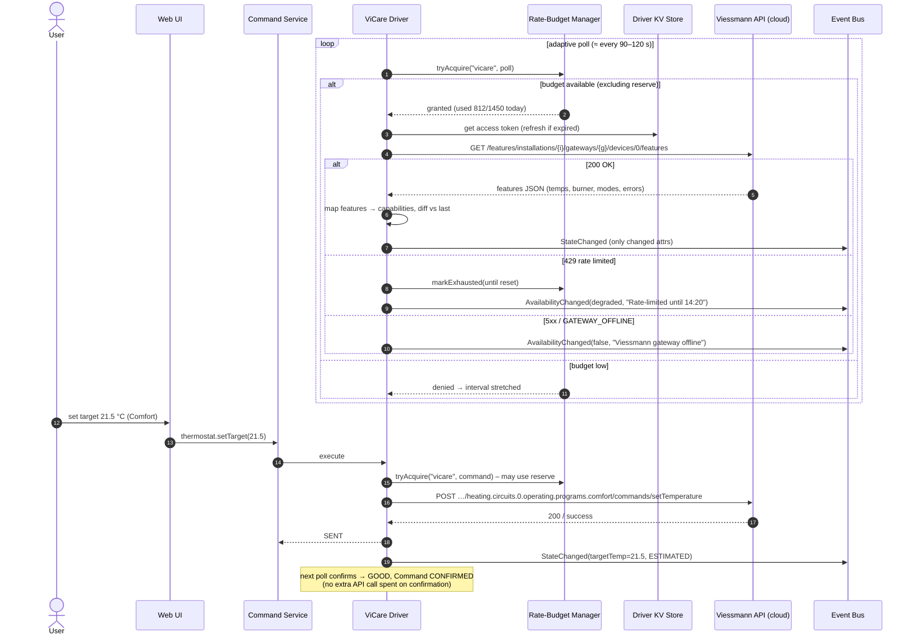

## SD-06 Device goes offline and recovers (health and incidents)

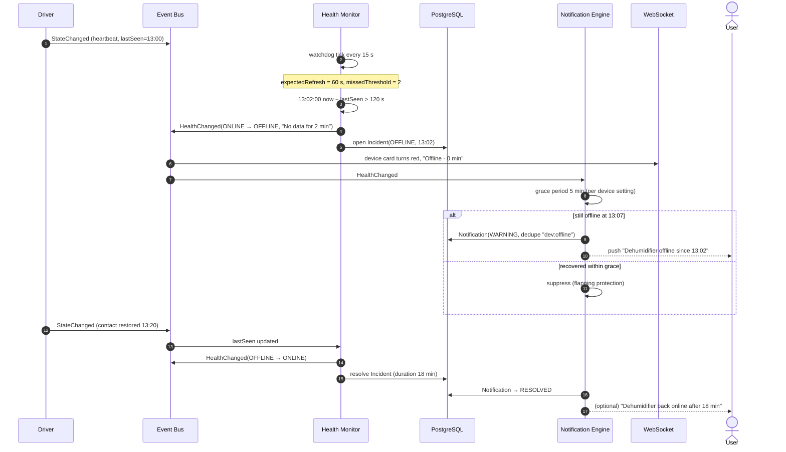

## SD-07 Live camera view (WebRTC via go2rtc)

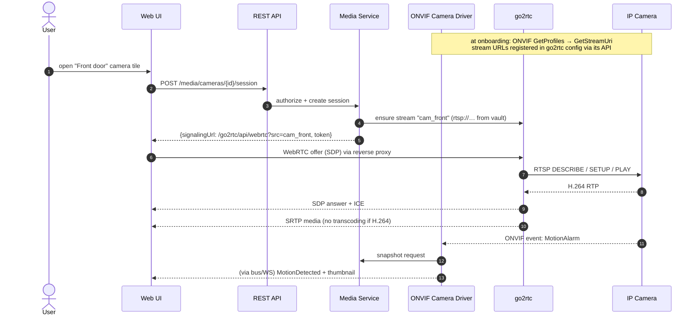

## SD-08 Print a document from the dashboard

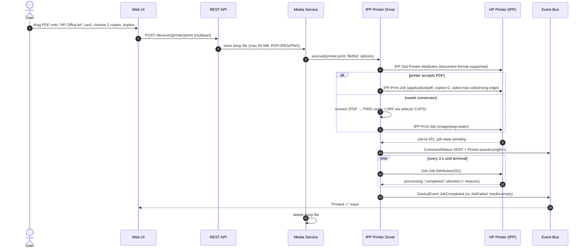

## SD-09 Sidecar driver: Roborock start room cleaning

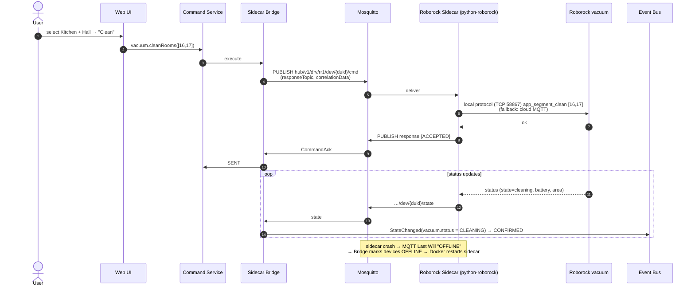

## SD-10 Network scan and unknown device alert

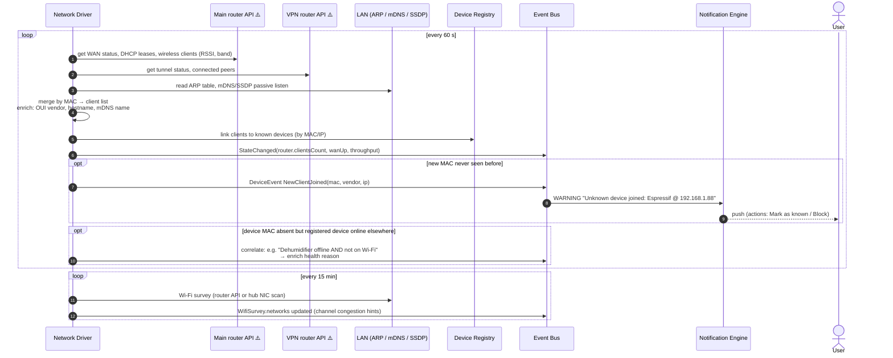

## SD-11 Fire alarm (X-Sense: local MQTT bridge + cloud fallback)

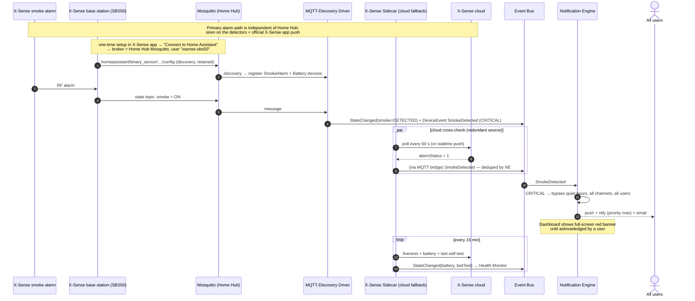

## SD-12 Login with 2FA and live session

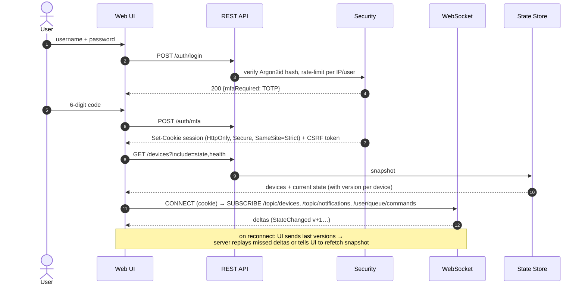
