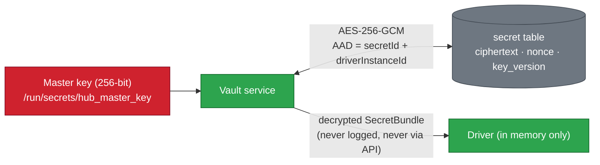
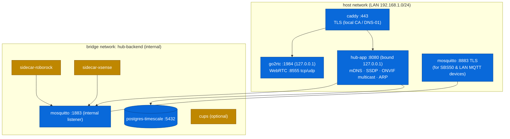

# 06: Security & Deployment

Home Hub can **open the main gate**, **show the cameras** and **change the heating**, and it holds credentials for several vendor clouds. That puts its security above that of a typical hobby project.

## 1. Threat model (summary)

| # | Threat | Impact | Mitigation |
|---|--------|--------|------------|
| T1 | Someone on the internet reaches the dashboard | Gate opened, cameras viewed | **No port forwarding.** Remote access is through the **VPN router only** ([ADR-006](08-decisions-and-open-questions.md)). Login is strong, with 2FA |
| T2 | A guest or IoT device on the LAN attacks the hub | Same as T1 | TLS on the LAN too (Caddy with a local CA), auth on every endpoint, rate-limited login, optional **IoT VLAN** separation |
| T3 | A stolen session or phone | Gate opened | **Step-up confirmation** (PIN / passkey) for dangerous commands, short re-auth window, session revocation from the admin UI |
| T4 | Database or backup leak | Vendor credentials exposed | **Credential vault**: AES-256-GCM, master key **outside** the database (Docker secret / file with 0400 permissions), key-version rotation |
| T5 | A compromised sidecar or community library | Lateral movement | Sidecars run as non-root with a read-only filesystem, own MQTT user, **topic ACLs** restricted to their own namespace, no Docker socket |
| T6 | Rogue MQTT clients | Spoofed alarms or commands | No anonymous MQTT; per-client users; ACLs; TLS listener for anything outside the Docker network |
| T7 | Vendor cloud account lockout (ViCare quota) | Heating invisible for 24 h | Rate-Budget Manager with a reserve |
| T8 | A supply-chain issue in dependencies | Various | Dependabot/Renovate, `mvn dependency-check` / Trivy image scans in CI, pinned image digests |
| T9 | False sense of safety (fire) | Life safety | The hub is a secondary channel only; UI copy says so; the alarm path does not depend on the hub |

## 2. Authentication and authorisation

| Item | Design |
|------|--------|
| Users | Local user store. Roles: **ADMIN** (everything, including integrations and users), **MEMBER** (use devices, acknowledge notifications), **GUEST** (time-limited, chosen devices only, e.g. "gate for the cleaner on Tuesdays 9–12") |
| Passwords | Argon2id; lockout with back-off after 5 failures |
| 2FA | TOTP (phase 9); **WebAuthn passkeys** (phase 9+, recommended on phones) |
| Sessions | Server-side sessions (Spring Session JDBC); cookie `HttpOnly; Secure; SameSite=Strict`; CSRF token for REST; WebSocket authenticated on CONNECT |
| Step-up | A per-capability policy decides which commands need confirmation: `Gate.open/trigger`, `NetworkRouter.reboot`, `NetworkClient.block`, `Camera.ptz` (optional). The proof is a 4–6 digit PIN or a passkey, valid for one command, with a 60 s TTL |
| Audit log | Every command records who, what, when, from which IP and the result. Logins and configuration changes are also recorded. The log is append-only and viewable by admins |
| API tokens | Long-lived personal tokens with limited scope, for scripts and future widgets (read-only by default) |

## 3. Credential vault



- Secrets are **write-only** through the API: the UI can replace a secret but never read it back.
- Driver tokens (OAuth refresh tokens, Tuya local keys) are stored through the same vault.
- Backups include the encrypted secrets **but not the master key**. The master key is backed up separately, for example printed or kept in a password manager.

## 4. Docker topology



**Why host networking for `hub-app`:** multicast discovery (mDNS, SSDP, ONVIF WS-Discovery, Tuya UDP broadcast) and ARP visibility do not cross Docker's default bridge NAT. The alternatives are a **macvlan** network, which gives the container its own LAN IP, or a small discovery helper on the host network. ADR-005 picks host networking for simplicity; macvlan is the documented alternative.

### Proposed `docker-compose.yml` (outline; finalised in phase 6)

```yaml
name: homehub

services:
  caddy:
    image: caddy:2
    network_mode: host
    volumes: [./caddy/Caddyfile:/etc/caddy/Caddyfile:ro, caddy-data:/data]
    restart: unless-stopped

  hub-app:
    image: ghcr.io/serkan/homehub-app:${HUB_VERSION}
    network_mode: host
    environment:
      HUB_DB_URL: jdbc:postgresql://127.0.0.1:5432/homehub
      HUB_MQTT_URL: tcp://127.0.0.1:1883
      HUB_GO2RTC_URL: http://127.0.0.1:1984
      JAVA_TOOL_OPTIONS: -XX:MaxRAMPercentage=60
    secrets: [hub_master_key, db_password]
    volumes: [hub-data:/var/lib/homehub]
    depends_on:
      postgres: { condition: service_healthy }
      mosquitto: { condition: service_started }
    healthcheck:
      test: ["CMD", "wget", "-qO-", "http://127.0.0.1:8080/actuator/health"]
    restart: unless-stopped

  hub-ui:          # static SPA files served by caddy (or baked into caddy image)
    image: ghcr.io/serkan/homehub-ui:${HUB_VERSION}
    volumes: [ui-dist:/srv/ui]

  postgres:
    image: timescale/timescaledb:latest-pg17
    ports: ["127.0.0.1:5432:5432"]
    environment: { POSTGRES_DB: homehub, POSTGRES_USER: homehub, POSTGRES_PASSWORD_FILE: /run/secrets/db_password }
    secrets: [db_password]
    volumes: [pgdata:/var/lib/postgresql/data]
    healthcheck: { test: ["CMD-SHELL", "pg_isready -U homehub"] }
    restart: unless-stopped

  mosquitto:
    image: eclipse-mosquitto:2
    ports: ["127.0.0.1:1883:1883", "8883:8883"]
    volumes: [./mosquitto:/mosquitto/config:ro, mqdata:/mosquitto/data]
    restart: unless-stopped

  go2rtc:
    image: alexxit/go2rtc
    network_mode: host
    volumes: [./go2rtc:/config]
    restart: unless-stopped

  sidecar-roborock:
    image: ghcr.io/serkan/homehub-sidecar-roborock:${HUB_VERSION}
    network_mode: host          # needs LAN reach to vacuum :58867
    read_only: true
    user: "1000:1000"
    environment: { HUB_MQTT_URL: tcp://127.0.0.1:1883, HUB_DRIVER_ID: roborock-1 }
    restart: unless-stopped

  sidecar-xsense:
    image: ghcr.io/serkan/homehub-sidecar-xsense:${HUB_VERSION}
    read_only: true
    user: "1000:1000"
    networks: [hub-backend]
    restart: unless-stopped
    profiles: ["xsense-cloud"]   # optional fallback

  backup:
    image: ghcr.io/serkan/homehub-backup:${HUB_VERSION}   # pg_dump + restic
    profiles: ["backup"]

secrets:
  hub_master_key: { file: ./secrets/hub_master_key }
  db_password:    { file: ./secrets/db_password }

volumes: { pgdata: {}, mqdata: {}, hub-data: {}, caddy-data: {}, ui-dist: {} }
networks: { hub-backend: { internal: true } }
```

> Note: services on `network_mode: host` reach Postgres and Mosquitto through `127.0.0.1` ports that are bound to localhost only, so nothing is exposed on the LAN apart from Caddy (443), MQTT TLS (8883) and go2rtc WebRTC (8555).

## 5. TLS and DNS

- **Option A (recommended):** own a domain (e.g. `home.example.com`) and use the **DNS-01** challenge with Let's Encrypt via Caddy. This gives a real certificate even though the hub is LAN/VPN-only. The local DNS on the router points `hub.home.example.com` → the hub's IP.
- **Option B:** Caddy's internal CA, with its root certificate installed on the family's devices.
- PWA install and Web Push need a **secure context**, so HTTPS is mandatory, not optional.

## 6. Remote access

- **VPN only** (WireGuard on the VPN router, or WireGuard/Tailscale on the hub host).
- Push notifications work without a VPN, because Web Push and ntfy deliver outward.
- Notification action buttons that need the hub (e.g. "Open gate") open the PWA, which only works when the VPN is connected. This is by design.

## 7. Backups and recovery

| What | How | Frequency |
|------|-----|-----------|
| PostgreSQL | `pg_dump` (custom format) → **restic** repository (NAS / USB / cloud bucket, encrypted) | Nightly, keep 7 daily, 4 weekly, 6 monthly |
| Config (`./caddy`, `./mosquitto`, `./go2rtc`, compose files) | Git repository (no secrets) | On change |
| Master key + DB password | Password manager / printed | Once |
| Restore drill | `make restore` script tested in CI against the latest dump | Monthly reminder |

## 8. Operations

- **Upgrades:** `docker compose pull && docker compose up -d`. Flyway migrates on start; an automatic pre-upgrade `pg_dump` runs first.
- **Self-monitoring:** `/actuator/health`, Prometheus metrics (driver status, event-bus lag, command latency, budget usage) and an optional Grafana dashboard. The hub raises **its own** notifications: "Disk 90 % full", "Backup failed", "Driver X restarting repeatedly".
- **Logs:** JSON to stdout → `docker logs`; optional Loki. Secrets are redacted by a logback mask.
- **Host sizing:** a mini PC (e.g. Intel N100, 8–16 GB RAM, SSD) is ideal. A Raspberry Pi 5 (8 GB) is enough without camera transcoding. A NAS with Docker works too.
