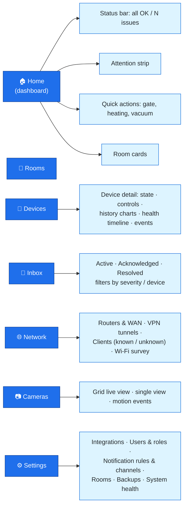
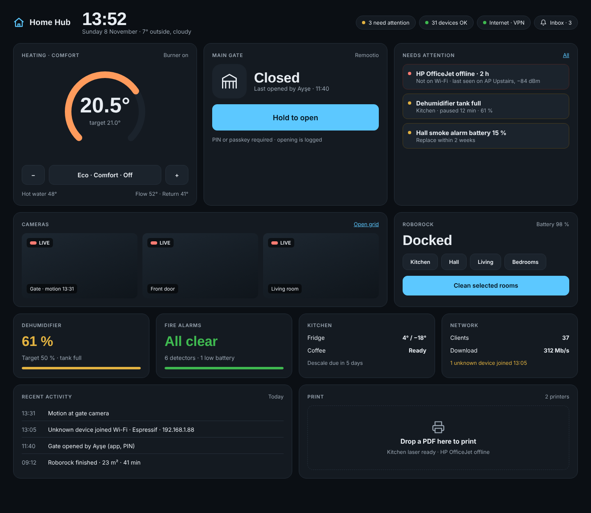

# 07: UI/UX Design

## 1. Design principles

1. **Glanceable first.** The home screen answers three questions within 2 seconds: *Is everything OK? What needs my attention? What can I quickly do?*
2. **Problems float up.** Offline, faulty and needs-attention devices are always visible at the top, never buried in a room tab.
3. **Live, but honest.** Values update in real time. Stale values are dimmed with "as of 13:02", and optimistic changes show a subtle spinner until the device confirms them.
4. **Calm by default.** Neutral surfaces, with colour reserved for status (red = offline/critical, amber = degraded/warning, green = OK, blue = active).
5. **Mobile-first PWA.** Large touch targets, installable, dark and light themes, works on wall tablets in kiosk mode.

## 2. Information architecture



## 3. Chosen direction: Night Console (Mockup B)

> **Decision (8 Nov 2026):** Of the three mockups in [`mockups/`](mockups/README.md), **B · Night Console** was chosen as the primary UI direction. See [ADR-012](08-decisions-and-open-questions.md#adr-012-night-console-as-the-primary-ui-direction).



**Why it was chosen:** it reads well from across a room (a wall tablet or kitchen display), the dark theme suits always-on screens and evening use, and the tile grid gives every device family a consistent, scannable home.

**Layout (desktop, 1440 px):**

| Row | Tiles (12-column grid) |
|-----|------------------------|
| Header | Brand · large clock and date/weather · status pills (attention count, devices OK, internet/VPN) · inbox button |
| 1 | **Heating** (4 cols: dial with current/target, mode, ±) · **Main gate** (4: state, last actor, large *Hold to open* with PIN/passkey) · **Needs attention** (4: up to 3 incidents, coloured by severity) |
| 2 | **Cameras** (8: 3 live WebRTC tiles with motion labels) · **Roborock** (4: state, battery, room chips, *Clean selected rooms*) |
| 3 | Four compact status tiles (3 cols each): **Dehumidifier** · **Fire alarms** · **Kitchen** (fridge + coffee) · **Network** |
| 4 | **Recent activity** feed (6) · **Print** drop zone (6) |

**Responsive behaviour:** below 1100 px, 3- and 4-column tiles become half-width and wide tiles become full-width. Below 700 px, every tile is full-width in the same order, so attention, gate and heating stay at the top on a phone.

**Kiosk mode** (`/kiosk`): the same layout with a larger clock, the inbox button hidden, and the screen dimming after inactivity. A CRITICAL event (smoke/CO) wakes the screen and shows a full-width red banner over the grid.

**Light theme:** the same grid with light tokens, offered as a user setting. Mockups A and C remain as references for a future light/"status board" view.

## 3a. Original wireframe (for reference)

```
┌──────────────────────────────────────────────────────────────────────────┐
│ 🏠 Home Hub            ● All systems OK  ·  2 need attention   🔔3   👤 │
├──────────────────────────────────────────────────────────────────────────┤
│ ⚠ NEEDS ATTENTION                                                        │
│ ┌──────────────────────┐ ┌──────────────────────┐ ┌───────────────────┐  │
│ │ 💧 Dehumidifier      │ │ 📡 Printer HP        │ │ 🔋 Hall smoke     │  │
│ │ Tank full · 12 min   │ │ Offline · 2 h        │ │ alarm · Batt 15 % │  │
│ │ [Snooze] [Details]   │ │ Not on Wi-Fi         │ │ [Details]         │  │
│ └──────────────────────┘ └──────────────────────┘ └───────────────────┘  │
├──────────────────────────────────────────────────────────────────────────┤
│ QUICK ACTIONS                                                            │
│ ┌────────────┐ ┌────────────────┐ ┌────────────┐ ┌────────────┐         │
│ │ 🚪 Gate    │ │ 🔥 Heating     │ │ 🤖 Vacuum  │ │ 🖨 Print   │         │
│ │ Closed     │ │ 20.5° → 21.0°  │ │ Docked 98% │ │ Drop file  │         │
│ │ [ Open ]   │ │ [−] Comfort [+]│ │ [ Clean ▾ ]│ │            │         │
│ └────────────┘ └────────────────┘ └────────────┘ └────────────┘         │
├──────────────────────────────────────────────────────────────────────────┤
│ ROOMS                                                                    │
│ ┌ Living room ──────────┐ ┌ Kitchen ──────────────┐ ┌ Garden ─────────┐  │
│ │ 21.2 °C  ·  48 %      │ │ ☕ Coffee: ready       │ │ 📷 Gate cam ▶   │  │
│ │ 📷 1 camera           │ │ 🧊 Fridge 4° / −18°   │ │ 🚪 Gate closed  │  │
│ └───────────────────────┘ └───────────────────────┘ └─────────────────┘  │
├──────────────────────────────────────────────────────────────────────────┤
│ SYSTEM  Internet ● up 14 d · VPN ● 1 tunnel · 37 devices on network      │
└──────────────────────────────────────────────────────────────────────────┘
```

## 4. Device card states

| State | Visual |
|-------|--------|
| ONLINE | Neutral card; live values; green dot (only on hover/detail, to keep it calm) |
| ESTIMATED (command in flight) | Value in italics + small spinner |
| STALE | Value at 50 % opacity + "as of 13:02" |
| DEGRADED | Amber left border + reason line ("Tank full", "Battery 15 %") |
| OFFLINE | Red left border, greyed controls, "Offline for 2 h · Not on Wi-Fi" + [Diagnose] |
| CLOUD_UNREACHABLE | Grey cloud icon, "Waiting for internet" (no red alarm) |
| CRITICAL event | Full-width red banner across all screens until acknowledged |

## 5. Device detail page

- **Header:** name, room, health chip, last seen, driver/integration link.
- **Controls:** rendered from the capability (thermostat dial, gate button with step-up, vacuum room picker, dehumidifier target slider).
- **History:** ECharts time-series of numeric attributes (humidity, temperatures, burner on/off as a band), with 24 h / 7 d / 30 d / custom ranges.
- **Health timeline:** a horizontal bar of ONLINE/DEGRADED/OFFLINE segments with incident tooltips, plus uptime %.
- **Events and commands:** a merged chronological feed ("Gate opened by Serkan · 08:14", "Tank full · 07:02").
- **Diagnostics (admin):** raw attributes, driver messages, network correlation (IP, MAC, AP, RSSI).

## 6. Design system

Tokens follow the chosen **Night Console** direction (dark is the default theme):

| Token | Value |
|-------|-------|
| Fonts | **Space Grotesk** (headings, big numbers, clock), **Inter** (UI text), JetBrains Mono (diagnostics) |
| Background / tile / raised | `#0b0f14` / `#141a21` / `#1b232c` |
| Border | `#26303b` |
| Text / muted text | `#e8edf2` / `#9aa6b2` (≥ 7:1 on tiles) |
| Accent (primary actions) | `#5cc8ff`, with dark text `#04121c` on it |
| Status colours | OK `#3fb950`, Warning `#e3b341`, Critical `#ff7b72`, Heating `#ff9b5c` |
| Radius | 18 px tiles, 12 px controls and inner cards |
| Grid | 12 columns, 16 px gap, max width 1440 px, 32 px page padding |
| Spacing | 4 px base scale |
| Touch targets | ≥ 48 px (64 px for the gate button) |
| Themes | Dark (default), light, auto (OS); high-contrast for wall tablets |
| Components | shadcn/ui (Radix) primitives: Card, Dialog, Sheet, Tabs, Slider, Toast, Command palette (⌘K "open gate", "clean kitchen") |
| Icons | Lucide |
| Motion | 150–200 ms ease-out; respects `prefers-reduced-motion` |
| Accessibility | WCAG 2.2 AA; status never shown by colour alone (icon + text) |

## 7. Notifications UX

- Bell with an unread count; the inbox is grouped by **Active / Acknowledged / Resolved**.
- Each item shows: icon, device, message, first/last occurrence, count ("×4"), and actions (Acknowledge, Snooze 1 h / until tomorrow, Go to device, Mute this type).
- Web Push actions: "Acknowledge" and "Open". Critical pushes use `requireInteraction`.
- Quiet hours are set per user; CRITICAL always breaks through.

## 8. Kiosk / wall-tablet mode

`/kiosk?token=…` gives a read-mostly dashboard with a large clock, attention strip, cameras and gate button (step-up required). The screen dims after inactivity and wakes on a critical event.
