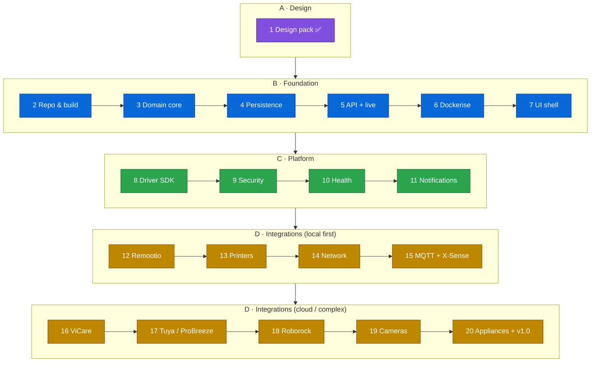
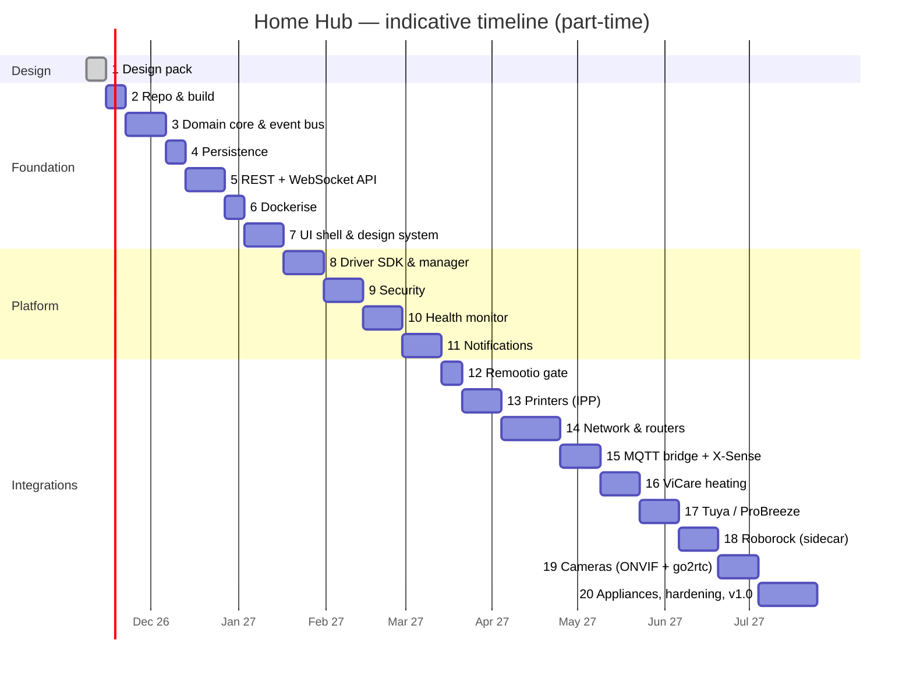

# 09: Roadmap: 20 Phases to v1.0

Every phase is **small, shippable and testable on its own**, and ends with a running system. The order is: design → foundation → platform features → integrations (easiest and most valuable first) → hardening.

**Sizing:** S ≈ 1 week, M ≈ 2 weeks, L ≈ 3 weeks of part-time work (evenings and weekends). The total is roughly **9–10 months** part-time.

## Overview

---

## A · Design

### Phase 1: Design pack ✅ (this document set) · S
- **Goal:** agree on the architecture before writing code.
- **Deliverables:** docs 00–09: architecture, domain model, driver SDK, sequence diagrams, integration specs, security/deployment, UI/UX, ADRs, roadmap.
- **Done when:** Serkan has reviewed the pack, the open questions in [08](08-decisions-and-open-questions.md#open-questions) are answered (or defaults accepted), and the proposed ADRs are accepted.

## B · Foundation

### Phase 2: Repository & build skeleton · S
- **Scope:** Git repo (mono-repo: `backend/`, `ui/`, `sidecars/`, `deploy/`, `docs/`). Maven multi-module (`hub-domain`, `hub-driver-sdk`, `hub-core`, `hub-persistence`, `hub-web`, `hub-app`, `drivers/`). Java 25 toolchain, Spotless formatting, Error Prone, ArchUnit module rules, JUnit 5 + AssertJ + Testcontainers. GitHub Actions CI (build, test, Trivy scan). This design pack is moved into `docs/`.
- **Done when:** `mvn verify` is green in CI; an empty Spring Boot app starts and `/actuator/health` = UP.

### Phase 3: Domain core & event bus · M
- **Scope:** `Device`, `Capability` (sealed types) and the v1 capability catalogue as records; `AttributeValue` with `Quality`; `Command` lifecycle state machine; `HubEvent` hierarchy. In-process **EventBus** (per-device ordering, virtual-thread subscribers, bounded queues). In-memory Device Registry and State Store. A **simulated driver** (fake thermostat, fake gate) that generates realistic data.
- **Done when:** unit tests cover the command lifecycle and event ordering; the simulated devices change state and the subscribers receive the changes in order.

### Phase 4: Persistence · S
- **Scope:** PostgreSQL + TimescaleDB via Testcontainers; Flyway migrations for the schema in [02 §7](02-domain-model.md#7-persistence-model-postgresql--timescaledb); repositories; `attribute_history` hypertable with retention and continuous aggregates; state recovery on start-up.
- **Done when:** after a restart, the registry and last-known state are restored; history queries return downsampled data.

### Phase 5: REST + WebSocket API · M
- **Scope:** `/api/v1` for devices, rooms, state, commands, history, events, with an OpenAPI spec and Swagger UI (dev only). STOMP WebSocket with topics, snapshot + delta versioning and resync on reconnect. Error model (RFC 9457 problem details). Temporary basic auth for dev.
- **Done when:** a command against a simulated device is fully observable over WebSocket; an API contract test suite passes.

### Phase 6: Dockerise · S
- **Scope:** Jib image for `hub-app`; `docker-compose.yml` with postgres-timescale, mosquitto, caddy (TLS) and hub-app (host networking); Docker secrets; health checks; a `.env` template; `make up/down/logs/backup`. Nightly `pg_dump` backup job.
- **Done when:** `docker compose up` on a clean machine gives a working hub at `https://hub.local` with simulated devices; the backup/restore script has been tested.

### Phase 7: UI shell & design system · M
- **Scope:** React + TS + Vite project; Tailwind + shadcn/ui; theme tokens (light/dark); app shell (nav, status bar, bell); **Home dashboard** with room cards and device cards generated from capabilities; device detail page with ECharts history; live updates through the STOMP client; PWA manifest. Served by Caddy.
- **Done when:** simulated devices appear live on the dashboard on desktop and mobile; Lighthouse PWA and accessibility scores are ≥ 90.

## C · Platform

### Phase 8: Driver SDK & Driver Manager · M
- **Scope:** `hub-driver-sdk` (SPI, `DriverContext`, JSON-Schema config, `RateBudget`, KV store); ServiceLoader discovery; supervised lifecycle with back-off restarts; **Integration UI** (add / configure / enable / disable, rendered from the schema); **driver test kit** and compliance suite. The simulated driver is ported onto the SDK.
- **Done when:** a driver can be added from the UI with no UI code; a crashing driver restarts without affecting the others.

### Phase 9: Security · M
- **Scope:** users and roles, Argon2id, login + **TOTP 2FA**, sessions, CSRF, **step-up confirmation** for dangerous commands, **credential vault** (AES-GCM, master key as a Docker secret), audit log, rate limiting, security headers. Remove basic auth.
- **Done when:** the OWASP ZAP baseline scan is clean; secrets cannot be read back through the API; gate-type commands demand a PIN.

### Phase 10: Health Monitor · M
- **Scope:** heartbeat watchdog, health state machine ([02 §4](02-domain-model.md#4-health-model)), condition rules, **incidents**, hub internet check → `CLOUD_UNREACHABLE`, per-device thresholds. UI: attention strip, health chips, health timeline, uptime %. **Hub self-health** (disk, DB, drivers, backup age).
- **Done when:** killing a simulated device produces OFFLINE within 2× its refresh interval, opens an incident and shows on the dashboard; recovery closes the incident.

### Phase 11: Notification engine · M
- **Scope:** rules from events and incidents; dedupe/grouping, quiet hours, snooze, auto-resolve; channels: **in-app inbox**, **Web Push (VAPID)**, **email (SMTP)**, optional **ntfy**; per-user preferences; CRITICAL full-screen banner.
- **Done when:** a simulated "tank full" event pushes to a phone once, repeats are collapsed, and the notification auto-resolves when cleared.

## D · Integrations

### Phase 12: Remootio gate · S
- **Scope:** Java `remootio` driver (WebSocket API v2, encryption, keep-alive, reconnect), mDNS discovery, `Gate` capability, step-up on open, "left open" rule, audit trail.
- **Done when:** the gate opens from the dashboard with a PIN in < 1 s on the LAN, and its state updates live when the gate is opened by remote or app.

### Phase 13: Printers (IPP) · M
- **Scope:** `ipp` driver (discovery `_ipp._tcp`, attributes, status, ink levels, jobs); **print from the dashboard** (drag and drop, options); optional CUPS sidecar for conversion; printer health (paper out, low ink).
- **Done when:** a PDF dropped onto the card prints with duplex, and "out of paper" raises a notification.

### Phase 14: Network & routers · L
- **Scope:** generic layer (ARP, ping sweep, mDNS/SSDP listener, OUI vendor DB, SNMP); WAN monitor; **vendor adapters** for the main router and VPN router (chosen after Q1/Q2); `NetworkRouter`, `NetworkClient`, `WifiSurvey`; **Network page** (clients known/unknown, VPN tunnels, Wi-Fi survey); **unknown-device alert**; offline-device ↔ Wi-Fi correlation.
- **Done when:** every client on the LAN is listed with vendor and hostname; a new phone joining triggers an alert; an offline device shows "not on Wi-Fi" when that is the cause.

### Phase 15: MQTT messaging, sidecar bridge & X-Sense · M
- **Scope:** Mosquitto hardening (users, ACLs, TLS listener); **Sidecar Bridge** + **MQTT Driver Protocol v1**; the `homehub-sidecar` Python helper package; the generic **MQTT-Discovery driver** (HA convention); **X-Sense SBS50 local bridge** connected to our broker; optional `xsense` cloud sidecar for liveness and battery; CRITICAL routing for smoke/CO.
- **Done when:** pressing the test button on a detector raises a CRITICAL notification on all phones (verified with a real test), and battery levels are visible.

### Phase 16: Viessmann ViCare heating · M
- **Scope:** OAuth PKCE onboarding flow; `vicare` driver; feature → capability mapping (circuits, DHW, diagnostics); **Rate-Budget Manager** with adaptive polling and reserve; budget usage shown in the UI; heating card (current/target, mode, burner); history charts (flow/return/outside temperatures).
- **Done when:** the heating target can be changed from the dashboard, there are no rate-limit bans over a 7-day soak test, and `GATEWAY_OFFLINE` is shown correctly.

### Phase 17: Tuya local / ProBreeze dehumidifier · M
- **Scope:** `tuya-local` driver (protocols 3.3/3.4/3.5, UDP discovery, persistent socket); local-key onboarding wizard (Tuya IoT platform); **YAML device profiles** (DP → capability), with a ProBreeze profile; dehumidifier card (target humidity, mode, tank status); `midea-local` variant only if the model needs it (Q7).
- **Done when:** the dehumidifier is controllable locally with the internet unplugged, and tank full → notification → auto-resolve.

### Phase 18: Roborock vacuum (sidecar) · M
- **Scope:** `roborock` sidecar on python-roborock (one-time cloud login, then local TCP); vacuum card (status, battery, start/pause/dock, **room selection**); consumables; error → notification; "clean when everyone is away" rule (if presence is available).
- **Done when:** rooms can be chosen and cleaned from the dashboard, and a stuck/error notification arrives within 1 min.

### Phase 19: Cameras (ONVIF + go2rtc) · M
- **Scope:** go2rtc container; `onvif` driver (WS-Discovery, profiles, stream URIs, snapshots, PTZ, motion events); Media Service sessions; camera grid and single view (WebRTC, HLS fallback); motion snapshot timeline (7 days).
- **Done when:** live view loads in < 2 s on the LAN and over VPN, and a motion event shows a thumbnail in the feed.

### Phase 20: Appliances, hardening & v1.0 release · L
- **Scope:**
  - **Appliances:** fridge and coffee-machine drivers (Home Connect / SmartThings / ThinQ, chosen per Q4/Q5).
  - **Rules engine v1:** simple when/then rules with UI.
  - **Hardening:** 14-day soak test, chaos tests (kill drivers, drop internet, restart the DB), performance check against the targets in [01 §8](01-architecture-overview.md#8-quality-attributes), backup restore drill, security review.
  - **Release:** user guide, `v1.0.0` tag, signed images.
- **Done when:** all listed devices are on one dashboard, the soak test passes the quality targets, and the v1.0 images are published.

---

## Beyond v1.0 (backlog)

| Item | Route |
|------|-------|
| Lights, switches, sensors (Zigbee) | Zigbee2MQTT + USB stick → MQTT-Discovery driver |
| Matter / Thread | python-matter-server sidecar |
| Visual automation builder + scenes | Extends the rules engine |
| Presence (phones on Wi-Fi, PWA geofence) | Network driver + PWA |
| Energy dashboard | Smart plugs (`PowerMeter`), utility meters |
| Camera recording / NVR | Frigate integration (object detection) |
| Voice | Local voice pipeline (Whisper + intents) |
| Home Assistant bridge | Long-tail devices via the HA WebSocket API |
| Multi-dashboard / kiosk layouts | Per-user and wall-tablet layouts |
| Public driver SDK & marketplace | Only if open-sourced (Q15) |

## Working agreement per phase

1. A short **phase brief** (goal, scope, done-when): copy it from this doc into a GitHub issue or milestone.
2. Build on a feature branch, with tests first for the domain logic.
3. A **demo** at the end of the phase (a short screen recording, or try it live).
4. Update the docs where reality differs from the design. Docs live next to the code in `docs/`.
5. Tag a release (`v0.<phase>.0`) and deploy to the home server.
